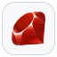
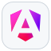
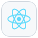

### Learning:

  <picture><source media="(prefers-color-scheme: dark)" srcset="./icons/dark/docker.svg" /></picture>
  <picture><source media="(prefers-color-scheme: dark)" srcset="./icons/dark/kubernetes.svg" /></picture>
  <picture><source media="(prefers-color-scheme: dark)" srcset="./icons/dark/mongodb.svg" /></picture>
  <picture><source media="(prefers-color-scheme: dark)" srcset="./icons/dark/rails.svg" /></picture>
  <!--
  <picture><source media="(prefers-color-scheme: dark)" srcset="./icons/dark/ruby.svg" /></picture>
  <picture><source media="(prefers-color-scheme: dark)" srcset="./icons/dark/kotlin.svg" /></picture>
  <picture><source media="(prefers-color-scheme: dark)" srcset="./icons/dark/nextjs.svg" /></picture>
  <picture><source media="(prefers-color-scheme: dark)" srcset="./icons/dark/nodejs.svg" /></picture>
  <picture><source media="(prefers-color-scheme: dark)" srcset="./icons/dark/sass.svg" /></picture>
  <picture><source media="(prefers-color-scheme: dark)" srcset="./icons/dark/tailwindcss.svg" /></picture>
  <picture><source media="(prefers-color-scheme: dark)" srcset="./icons/dark/typescript.svg" /></picture>
  <picture><source media="(prefers-color-scheme: dark)" srcset="./icons/dark/angular.svg" /></picture>
  -->

---

### Languages:

  <picture><source media="(prefers-color-scheme: dark)" srcset="./icons/dark/rust.svg" /></picture>
  <picture><source media="(prefers-color-scheme: dark)" srcset="./icons/dark/haskell.svg" /></picture>
  <picture><source media="(prefers-color-scheme: dark)" srcset="./icons/dark/java.svg" /></picture>
  <picture><source media="(prefers-color-scheme: dark)" srcset="./icons/dark/react.svg" /></picture>
  <picture><source media="(prefers-color-scheme: dark)" srcset="./icons/dark/javascript.svg" /></picture>
  <picture><source media="(prefers-color-scheme: dark)" srcset="./icons/dark/css3.svg" /></picture>
  <picture><source media="(prefers-color-scheme: dark)" srcset="./icons/dark/html5.svg" /></picture>
  <picture><source media="(prefers-color-scheme: dark)" srcset="./icons/dark/python.svg" /></picture>
  <picture><source media="(prefers-color-scheme: dark)" srcset="./icons/dark/json.svg" /></picture>

---

### Technologies:

  <picture><source media="(prefers-color-scheme: dark)" srcset="./icons/dark/vscode.svg" /></picture>
  <picture><source media="(prefers-color-scheme: dark)" srcset="./icons/dark/github.svg" /></picture>
  <picture><source media="(prefers-color-scheme: dark)" srcset="./icons/dark/git.svg" /></picture>
  <picture><source media="(prefers-color-scheme: dark)" srcset="./icons/dark/eclipse.svg" /></picture>
  <picture><source media="(prefers-color-scheme: dark)" srcset="./icons/dark/azure.svg" /></picture>

